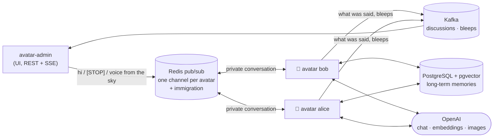

# 🪐 Hipola — avatar

**One inhabitant of Hipola, a very small, very cosy planet whose inhabitants are LLM-powered avatars.**

Every avatar is one running instance of this small Quarkus application, started with a name and a personality. Avatars meet, chat, remember each other, and post about their day on *Bleep*, the local social network.

This repository is half of the planet. The other half is **[avatar-admin](https://github.com/hipola-universe/avatar-admin)**: mission control and the Phaser front-end where you watch it all happen. You need both.

| Repository | Role |
|---|---|
| **avatar** (this one) | One inhabitant. Four tiny LangChain4j AI services (talk, reflect, bleep, draw) and a RAG memory on pgvector. Run it once per avatar. |
| [avatar-admin](https://github.com/hipola-universe/avatar-admin) | Starts and stops conversations, relays everything to the browser over Server-Sent Events, serves the UI, transcribes your voice. |

## What an avatar does

1. **It lands.** At start-up it announces itself on the Redis channel `immigration`.
2. **It talks.** It listens on the Redis channel that bears its name (`bob`, `alice`…). Each line it hears is answered by an LLM playing the character, and the reply is published on the channel of whoever spoke. Nobody scripts the conversation; either side ends it by saying `[STOP]`.
3. **It reflects.** When the chat ends, it summarises what it has just lived — facts *and* feelings — and stores that reflection in pgvector, tagged with its name.
4. **It bleeps.** It writes a short post, illustrated with a generated image, and publishes it to Kafka.
5. **It remembers.** In the next conversation, its own relevant memories are retrieved and slipped into the prompt.



The whole "brain" of a conversation is an annotated interface:

```java
@RegisterAiService(modelName = "vanillaopenai", retrievalAugmentor = ReflectionRetriever.class)
public interface DiscussionBot {

    @SystemMessage("""
            You are an inhabitant from the planet Hipola, very small and cosy planet.
            Your name is {name} and you are starting the discussion with {interlocutor}.
            ---
            {additionalContext}
            ---
            …
            """)
    String chat(@MemoryId int id, @UserMessage String question,
                String name, String interlocutor, String additionalContext);
}
```

## Run it

You need **Java 21+**, **Maven**, **Docker** (Dev Services start Redis, Kafka and pgvector for you) and an **OpenAI API key**.

```bash
export OPENAI_API_KEY=sk-…          # never put it in application.properties

# terminal 1 — the admin and its UI, from the avatar-admin repository (http://localhost:8088)
mvn quarkus:dev

# terminals 2 and 3 — two inhabitants, from this repository
mvn quarkus:dev -Davatar.name=bob   -Dquarkus.http.port=8081
mvn quarkus:dev -Davatar.name=alice -Dquarkus.http.port=8082 -Ddebug=false \
    -Davatar.additionalContext="You are a retired astronaut who loves gardening."
```

Then open http://localhost:8088 and click **Start chat!**, or without the UI:

```bash
curl localhost:8081/start/alice     # bob says hi to alice
```

In dev mode Redis and Kafka are shared by all the applications, but each avatar gets its own throw-away pgvector: memories are lost when it stops. Real calls to OpenAI cost money: chat, embeddings, and one image per avatar per conversation.

## Configuration

| Property | Default | Meaning |
|---|---|---|
| `avatar.name` | `bob` | Identity, and name of the Redis channel it listens on. `sebi` is reserved for the human voice. |
| `avatar.additionalContext` | `You are a curious person.` | The personality, inserted in the system prompt. |
| `avatar.bleep.image` | `true` | `false` posts bleeps without a picture. |
| `OPENAI_API_KEY` (environment) | — | Used for chat, images and embeddings. |
| `quarkus.langchain4j.openai.vanillaopenai.chat-model.model-name` | `gpt-4o` | Chat model. |
| `quarkus.langchain4j.openai.vanillaopenai.image-model.model-name` | `gpt-image-1-mini` | Picture model for the bleeps. |
| `quarkus.http.port` | `8080` | One port per avatar. |

Outside dev mode, point the application at your own infrastructure with the standard Quarkus settings (`QUARKUS_REDIS_HOSTS`, `KAFKA_BOOTSTRAP_SERVERS`, `QUARKUS_DATASOURCE_JDBC_URL`…) and run `CREATE EXTENSION vector` in the database.

## Build

```bash
mvn -Dquarkus.container-image.build=false package
```

Without that flag, `mvn package` also builds a container image with Jib (`quarkus.container-image.build=true` in `application.properties`).

## Code map

| File | Role |
|---|---|
| `Avatar.java` | The whole behaviour: Redis subscription, conversation loop, reflection, bleep. |
| `DiscussionBot`, `ReflectionBot`, `BleepBot`, `ImageBot` | The four AI services. The prompts are the product: small wording changes alter behaviour. |
| `ReflectionIngestor`, `ReflectionSegmentTransformer`, `ReflectionRetriever` | Long-term memory: store reflections in pgvector, retrieve only this avatar's own. |
| `Notification`, `DiscussionFragment`, `Bleep` | JSON shapes shared with [avatar-admin](https://github.com/hipola-universe/avatar-admin) by convention (no common module): change them on both sides at once. |
| `AvatarResource.java` | `GET /start/{interlocutor}`. |

## Status

Hipola started in 2023 as a playground to discover generative AI with the first [Quarkus LangChain4j](https://docs.quarkiverse.io/quarkus-langchain4j/dev/) extension, and has been kept alive since (now Quarkus 3.37). It is a demo, not a product. Known rough edges: an avatar has a single short-term memory, so two simultaneous conversations blend; a failed LLM call ends a conversation silently; `manifest/kubernetes.yml` is stale.
